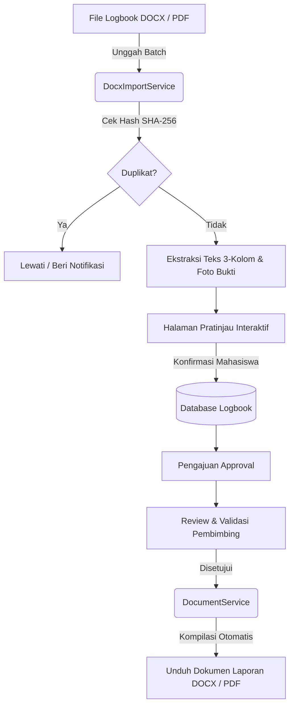

# Logbook Generator

[](https://laravel.com)
[](https://php.net)
[-success?style=for-the-badge&logo=php)](file:///tests)
[](LICENSE)

**Logbook Generator** adalah sistem manajemen aktivitas harian Praktik Kerja Lapangan (PKL) dan magang modern. Aplikasi ini dirancang untuk mempermudah mahasiswa dalam mencatat aktivitas harian, mengekstrak dokumen lama secara otomatis dari Microsoft Word (`.docx`) dan PDF (`.pdf`), memfasilitasi proses peninjauan oleh dosen pembimbing, serta mengompilasi laporan akhir siap cetak dalam format **DOCX** dan **PDF** lengkap dengan lembar pengesahan resmi.

> [!TIP]
> ### 📥 Akses Langsung Unduh Template Laporan (.docx)
> Butuh format dokumen standar yang siap diisi offline dan 100% kompatibel dengan ekstraksi otomatis sistem ini?
> - **Direct Download (File Repo):** [Template_Logbook_PKL.docx](public/templates/Template_Logbook_PKL.docx)
> - **Direct Download (Web Route):** Akses langsung via peramban pada URL `http://localhost:8000/template-logbook` (tanpa perlu autentikasi login).

---

## Daftar Isi

1. [Fitur Utama](#fitur-utama)
2. [Tumpukan Teknologi](#tumpukan-teknologi)
3. [Arsitektur & Alur Kerja](#arsitektur--alur-kerja)
4. [Persyaratan Sistem](#persyaratan-sistem)
5. [Panduan Instalasi](#panduan-instalasi)
6. [Akun Pengujian Bawaan](#akun-pengujian-bawaan)
7. [Format Dokumen & Ekstraksi Cerdas](#format-dokumen--ekstraksi-cerdas)
8. [Pengujian Otomatis](#pengujian-otomatis)
9. [Lisensi](#lisensi)

---

## Fitur Utama

### 1. Manajemen Aktivitas Harian (Logbook)
- Pencatatan aktivitas terstruktur per hari kerja (Hari Ke-X, tanggal, bidang pekerjaan, deskripsi kegiatan, tools yang digunakan, kendala, dan solusi).
- Status siklus hidup aktivitas: **Draft**, **Menunggu Approval**, **Disetujui**, dan **Revisi**.
- Dukungan unggah multi-gambar bukti dokumentasi kegiatan per hari.

### 2. Ekstraksi Otomatis Multi-Format (DOCX & PDF)
- **Ekstraksi Batch**: Mendukung unggah beberapa file dokumen Microsoft Word (`.docx`) dan Adobe Acrobat (`.pdf`) sekaligus dalam satu sesi.
- **Ekstraksi Gambar Otomatis**: Menangkap foto dokumentasi langsung dari struktur internal dokumen DOCX (Drawing XML) maupun aliran halaman PDF secara presisi.
- **Deteksi Duplikasi Cerdas**: Pencegahan unggah file identik secara *real-time* berbasis algoritma hashing SHA-256 (baik dalam satu batch unggahan maupun terhadap riwayat historis).
- **Halaman Pratinjau Interaktif**: Meninjau data sebelum disimpan ke database, pengeditan teks dinamis, penambahan/penggantian foto secara manual, serta opsi penanganan konflik (*overwrite* data lama atau lewati).

### 3. Template Laporan Siap Pakai
- Menyediakan dokumen template resmi Microsoft Word (`.docx`) terstandarisasi institusi yang dapat diunduh langsung oleh mahasiswa maupun pembimbing.
- Template sudah diformat dengan tabel 3 kolom dan penanda hari yang kompatibel 100% dengan mesin impor sistem.

### 4. Ekspor Dokumen Resmi (Word & PDF)
- **Ekspor Dokumen Penuh**: Seluruh aktivitas harian dari awal hingga akhir PKL.
- **Ekspor Mingguan**: Pengelompokan logbook otomatis berdasarkan minggu kerja (Senin &ndash; Jumat).
- **Ekspor Rentang Tanggal Kustom**: Fleksibilitas memilih tanggal mulai dan akhir laporan.
- **Format Siap Cetak**: Mengikuti tata letak institusional lanskap (A4), mencakup cover resmi, logo kampus dinamis, lembar pengesahan berpenanda tangan pembimbing lapangan, dan tabel aktivitas rapi.

### 5. Multi-Peran & Kolaborasi (RBAC)
- **Mahasiswa**: Mengelola profil PKL, mengisi aktivitas harian, mengimpor dokumen, mengunduh laporan, dan mengajukan persetujuan ke pembimbing.
- **Dosen / Pembimbing**: Memantau perkembangan mahasiswa bimbingan, meninjau logbook harian, memberikan catatan revisi, menyetujui aktivitas, dan mengisi evaluasi nilai akhir.
- **Administrator**: Mengelola data master mahasiswa, pembimbing, perusahaan mitra, dan penugasan PKL.

### 6. Desain Antarmuka Modern & Tanpa Ketergantungan Berat
- Dibangun dengan **Vanilla CSS** berbasis token warna modern dan responsif.
- Komponen modal konfirmasi kustom yang bersih dan elegan (menggantikan dialog bawaan browser).

---

## Tumpukan Teknologi

| Komponen | Teknologi | Keterangan |
| :--- | :--- | :--- |
| **Backend Framework** | [Laravel 12.x](https://laravel.com) | Framework PHP modern berbasis MVC |
| **Bahasa Pemrograman** | [PHP 8.2+](https://php.net) | Dengan ekstensi `zip`, `gd`/`imagick`, `dom`, `xml` |
| **Database** | MySQL 8.0+ / MariaDB / SQLite | Relasional dengan migrasi & seeder bawaan |
| **Pemrosesan Word** | [PHPOffice / PHPWord](https://github.com/PHPOffice/PHPWord) | Ekstraksi dan generasi dokumen `.docx` |
| **Pemrosesan PDF** | [DomPDF](https://github.com/barryvdh/laravel-dompdf) & [PdfParser](https://github.com/smalot/pdfparser) | Generasi & parsing teks/gambar dokumen `.pdf` |
| **Template Dokumen** | Microsoft Word (`.docx`) | Standar institusi 3 kolom &bull; [Unduh Langsung](public/templates/Template_Logbook_PKL.docx) |
| **Frontend** | Blade Templates, Vanilla CSS, Vanilla JS | Performa tinggi tanpa dependensi framework JS eksternal |
| **Testing** | PHPUnit 11 | 52 skenario pengujian unit & fitur (100% coverage green) |

---

## Arsitektur & Alur Kerja



---

## Persyaratan Sistem

- PHP `>= 8.2`
- Ekstensi PHP yang dibutuhkan:
  - `ext-zip`
  - `ext-gd` atau `ext-imagick`
  - `ext-dom`
  - `ext-xml`
  - `ext-mbstring`
  - `ext-pdo`
- Composer `>= 2.2`
- Database Server: MySQL `>= 8.0`, MariaDB `>= 10.4`, atau SQLite 3
- Web Server: Apache / Nginx / Laragon / PHP Built-in Server

---

## Panduan Instalasi

### 1. Kloning Repositori
```bash
git clone https://github.com/23Barajapu/logbook-generator.git
cd logbook-generator
```

### 2. Pasang Dependensi PHP
```bash
composer install
```

### 3. Konfigurasi Lingkungan (`.env`)
Salin berkas konfigurasi `.env.example` menjadi `.env`:
```bash
cp .env.example .env
```
Sesuaikan konfigurasi koneksi database Anda di dalam berkas `.env`:
```env
DB_CONNECTION=mysql
DB_HOST=127.0.0.1
DB_PORT=3306
DB_DATABASE=logbook_generator
DB_USERNAME=root
DB_PASSWORD=
```

### 4. Buat Application Key
```bash
php artisan key:generate
```

### 5. Jalankan Migrasi & Seeder Database
```bash
php artisan migrate --seed
```

### 6. Hubungkan Direktori Storage
```bash
php artisan storage:link
```

### 7. Jalankan Server Lokal
```bash
php artisan serve
```
Aplikasi kini dapat diakses melalui peramban web pada alamat: `http://localhost:8000`.

---

## Akun Pengujian Bawaan

Setelah menjalankan `db:seed`, akun-akun berikut siap digunakan:

| Peran (Role) | Email | Password | Hak Akses |
| :--- | :--- | :--- | :--- |
| **Administrator** | `admin@logbook.ac.id` | `password` | Manajemen master data & penugasan |
| **Dosen Pembimbing** | `pembimbing@logbook.ac.id` | `password` | Review aktivitas & penilaian akhir |
| **Mahasiswa** | `mahasiswa@logbook.ac.id` | `password` | Logbook harian, impor, dan ekspor dokumen |

---

## Format Dokumen & Ekstraksi Cerdas

Sistem dirancang untuk membaca dokumen logbook secara otomatis berdasarkan struktur baku berikut:

1. **Penanda Hari & Tanggal**:
   Paragraf heading dengan pola teks:
   `Hari Ke-[Nomor], Tanggal [Tanggal Bulan Tahun]`
   *Contoh:* `Hari Ke-1, Tanggal 3 Agustus 2026`

2. **Struktur Tabel 3 Kolom**:
   - **Kolom 1 &mdash; Bidang Pekerjaan**: Divisi kerja (contoh: *Quality Control*, *Web Development*).
   - **Kolom 2 &mdash; Kegiatan & Bukti**: Uraian rincian pekerjaan dan foto/tangkapan layar bukti kegiatan.
   - **Kolom 3 &mdash; Tools, Masalah & Solusi**: Catatan alat yang dipakai, kendala yang dihadapi, serta solusi pemecahannya.

> [!TIP]
> **Unduh Template Dokumen**: Mahasiswa dapat mengunduh format dokumen siap pakai langsung melalui rute publik `/template-logbook`, halaman impor logbook, atau melalui modal unduh laporan.

---

## Pengujian Otomatis

Aplikasi dilengkapi dengan rangkaian pengujian fitur dan unit komprehensif menggunakan PHPUnit:

```bash
# Menjalankan seluruh test suite
php artisan test

# Menjalankan pengujian impor dokumen DOCX & PDF
php artisan test --filter DocxImportTest

# Menjalankan pengujian generator dokumen DOCX & PDF
php artisan test --filter DocumentTest
```

**Status Pengujian Terkini**:
- **52 tests passed** (240 assertions) &mdash; 100% Green.

---

## Lisensi

Proyek ini dilisensikan di bawah [Lisensi MIT](LICENSE). Bebas digunakan, dikembangkan, dan disesuaikan untuk kebutuhan institusi pendidikan maupun industri.
